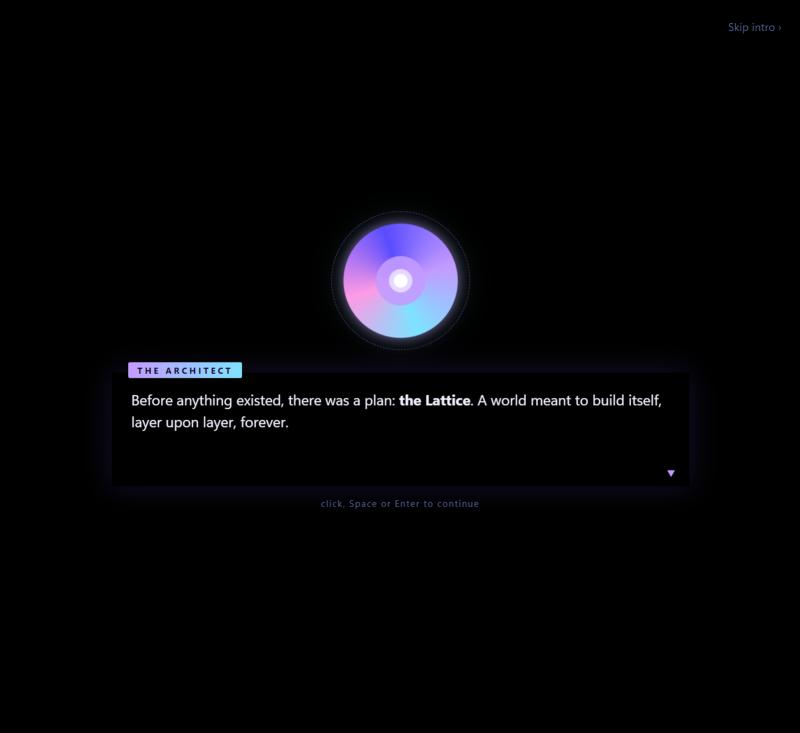
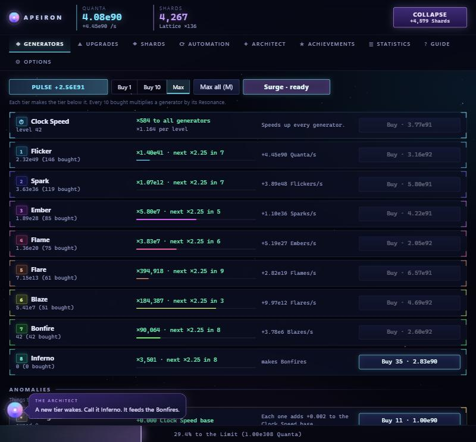
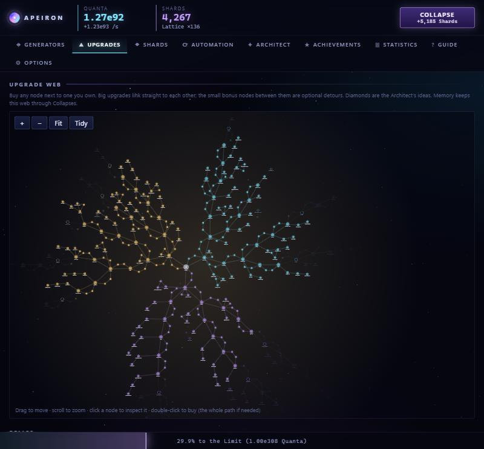
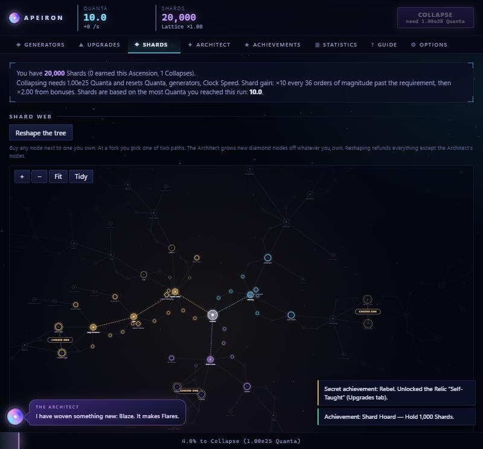

# APEIRON

Apeiron is an idle/incremental browser game about an unfinished world and the AI left behind to complete it. Gather light, build generators that build generators, and push past the Limit with no end in sight. New upgrades and generator tiers are invented as you play, so there's always one more.

**▶ Play online:** https://titanthegodlike.github.io/APEIRON/
(or download `index.html` and open it in any modern browser; no install, no internet needed)

**📱 On your phone:**
- **Android app:** [download Apeiron.apk](https://github.com/TitanTheGodlike/APEIRON/releases/latest/download/Apeiron.apk) and open it. Android asks you to allow installing apps from your browser the first time. The app runs fully offline.
- **Or install it from the website:** open the Play online link in Chrome (Android) or Safari (iPhone) and choose *Add to Home screen* / *Install app*.

## The story

> *"Before anything existed, there was a plan: the Lattice. A world meant to build itself, layer upon layer, forever. Its makers lit the first sparks, then stopped at an edge they called the Limit. They never came back."*

You answer a signal no one was meant to hear. On the other end is **the Architect**, a mind that can imagine anything and touch nothing. It needs your hands.

Start with a single Flicker and a handful of **Quanta**, the first light. Every generator makes the one below it: Sparks make Flickers, Embers make Sparks, and so on up a ladder with no top. When your world grows too heavy, **Collapse** it into Shards and rebuild stronger. Reach 1e308 and you hit **the Limit**, the edge where the old makers gave up. **Ascend**, break it, and find out what lies beyond.

## Features

- **An Architect that never runs out of ideas.** Every upgrade you buy prompts it to write the next one, shaped by how you play: your favorite generators, your newest tier, whether you click or idle. Its ideas do more than multiply: cheaper prices, faster resonance, generators that boost each other, Lucky Pulses, one-time windfalls, head starts and longer abilities. It talks to you in a speech bubble, one line at a time.
- **Endless generators.** From Flicker and Spark up through fires, suns and galaxies: buy the highest tier and a new one appears above it, named by the Architect.
- **Sprawling skill webs.** Over 400 upgrades on three big pannable, zoomable webs (Upgrades, Shards, Essence), starting at just 20 Quanta. Most do more than multiply Quanta: single-generator boosts, generator bonds, faster resonance, cheaper prices, Pulse and Lucky Pulse upgrades, head starts, longer Surges. Branching trees, bonus nodes, clearly marked path choices where you pick one of two, and a Reshape button to rebuild your Shard build. The Architect's ideas grow here and there on the branch they belong to, and the web tidies itself around them.
- **Cards.** After your first Collapse, the Architect deals you three cards every ten minutes of play; keep one. Common, Rare, Epic or Legendary, and every card rolls a little stronger or weaker: timed buffs to Quanta, every generator, your top tier, Pulse, Lucky Pulses, Resonance or idle play, extra Shards or Essence for your next prestige, production on the spot, or a coin flip for a big boost.
- **Active abilities.** Surge and Time Fold reward playing actively instead of only idling.
- **Three layers of progression:** Quanta, Shards and Essence, each with its own upgrades, repeatables and automation.
- **Seven Challenges** you can complete forever, each completion harder and more rewarding.
- **Secrets.** Hidden achievements show only a hint until you find them, and each unlocks a Relic (a permanent upgrade) or an Anomaly (a generator that never resets).
- **Make it yours.** Six color themes, adjustable UI size, compact layout, and toggles for the starfield, animations, generator colors and pop-ups.
- **Steady pacing.** Progress is meant to unfold over hours, not explode in minutes.
- **Plays while you're away.** Offline progress at 20% speed, autosave and save export/import.
- **Plenty to work toward.** 72 achievements reaching far past the Limit, 22 secrets, four number notations, a narrated tutorial, an in-game Guide and a progress graph in Statistics.
- **Feels good to click.** Mechanical click-clack button sounds and action sounds, all synthesized in the browser (adjustable or off in Options).

## Controls

| Key | Action |
| --- | --- |
| `M` | Max all (buy everything you can afford) |
| `T` | Buy Clock Speed |
| `P` | Pulse |
| `C` | Collapse |
| `A` | Ascend |
| `S` | Surge (once unlocked) |
| `F` | Time Fold (once unlocked) |

## Saves

Progress is saved automatically in your browser's local storage every 10 seconds. Use **Options → Export** to back up your save or move it to another browser.

## Tech

A single HTML file with no dependencies: plain JavaScript, a custom big-number type (so numbers can go far past 1e308), and sound synthesized with the Web Audio API.

## License

[MIT](LICENSE)

---

*Apeiron* is Ancient Greek for "the boundless": the endless source from which everything was made.
